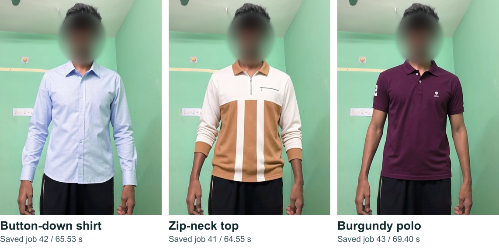
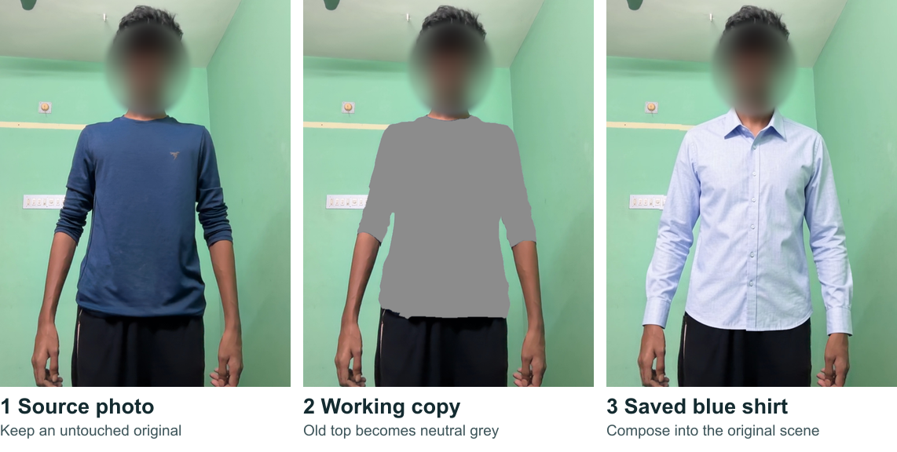

# WeFit

WeFit is a local virtual try-on research project. Give the Apple Silicon renderer a person photo and a garment photo. It locates the clothing, edits that area with FLUX.2 Klein 9B and returns a photograph. The research code runs independently of the account-based studio.

## V2 · Inside the model

We trained a **16,896-parameter LoRA adapter** on the final image layer while keeping the original 9B transformer frozen. Fourteen Fashionpedia photographs supplied training targets, five selected the adapter and five tested it. The interactive inspector lets you pick a shirt patch, see its numerical response, follow a connection into the output and read how training changed it. It also shows measurements at **all 32 transformer blocks** and the results of bypassing blocks or changing their weight precision.

The learned correction reduced held-out error in the model’s internal image representation. After decoding, the garment was closer to the known photograph in **one of five** photos. Mean garment pixel error rose from **26.75 to 27.69** on a 0–255 scale. The ordinary preset keeps the frozen model. Five validation photos selected full correction strength. That choice also increased error on the held-out photographs. [Per-image comparison](docs/study-v2/evidence/held-out.csv)

[Download the interactive inspector](https://github.com/HXRIkumar/WeFit/releases/download/v2.0.0/inside-klein.html) and open it in your browser. It works offline on Mac or Windows. [Read the V2 findings](docs/study-v2/README.md) · [PDF report](docs/study-v2/WeFit-V2-study.pdf) · [Training diagram and Mermaid source](docs/study-v2/diagrams) · [Reproduce the experiments](docs/study-v2/REPRODUCE.md) · [Trained adapters](docs/study-v2/adapters)

For repeated experiments on the **same** person, garment and seed, we saved the final layer’s input once. At 256 × 320 pixels, changing the adapter then took a median **0.650 s** to decode, against **42.614 s** for a full render. Fifteen of 15 independently rendered comparisons matched pixel-for-pixel. A fresh person or product needs the full editor. [Timing and equivalence checks](docs/study-v2/evidence/replay.json)

On the M4 Air, a fresh worker answered after **6.80 s**. The first complete photo took **55.37 s**. Across **20 subsequent requests**, the median was **110.44 s**, the nearest-rank p95 was **142.29 s**, and all 20 crops completed in one pass. Each request generated a new result. Together these four cases cover one person, two camera captures and three products. [Raw request timings](docs/study-v2/evidence/requests.jsonl)

The running Q3/Q4 experiment saved **163.6 MB** and raised garment RGB error from **27.69 to 28.01** against the matched Q4 adapter. For storage, lossless compression of the original model saved **503.5 MB (9.5%)**. All ten original files matched after decompression. Running that archive requires extracting it first. [Precision experiment](docs/study-v2/evidence/mixed-checkpoint.json) · [File-by-file archive verification](docs/study-v2/evidence/archive.json)

## V1 · From the handoff to the local photo editor

**Measured on the M4 MacBook Air:** a 1024-pixel development run took **251.87 s** to render; the optimized blue-shirt request took **56.36 s** on the local client. These are different configurations and clocks. The original handoff has no logged AI runtime. The controlled three-pair experiment below isolates region rendering.

| Computer | What is available | What has been tested |
|---|---|---|
| Apple Silicon Mac, 24 GB in the test | This public Klein 9B renderer and the full studio | Real local generation, photographed garments and measured timing |
| Windows with an NVIDIA GPU | FASHN/PyTorch in the [complete studio](https://github.com/HXRIkumar/wefit-studio) | A Windows GPU run is pending. The 56.36 s figure is a Mac observation. |


The original project was supplied by a collaborator. Its default local overlay positioned a product cutout over the body. It also offered hosted and self-hosted AI options. The archive includes no measured AI run identifying the collaborator's engine, hardware and inputs. The centre image is a fresh replay of its default overlay on the same person and blue garment. In that replay the old navy top remains visible above the collar.

**Read the illustrated [engineering report (PDF)](docs/portfolio/WeFit-engineering-report.pdf) or [editable Word version](docs/portfolio/WeFit-engineering-report.docx).** The [interview and demo guide](docs/portfolio/INTERVIEW_AND_DEMO.md) explains each technical term and gives a short presentation script.

## What the project measures

On an M4 MacBook Air with 24 GB, the service rendered the same person and blue shirt six times. The only requested change was the editing region. Each pair used the same model, source bytes, seed 42, neutral clothing conditioning, guidance 1.0 and three steps.

| Region | Pixels rendered | Median service time | Individual times |
|---|---:|---:|---|
| Full photograph | 442,368 | 100.90 s | 67.13, 103.79, 100.90 s |
| Clothing and surrounding context | 331,776 | 83.17 s | 62.05, 88.10, 83.17 s |

The clothing crop reduced median service time by **17.6%**. Each of three pairs finished sooner, with zero crop retries. This experiment covers one person and one garment. The CSV includes timings, queue wait, pixel counts, peak MLX allocation, input hashes and the pinned model revision. [Six recorded requests](docs/portfolio/evidence/region-runs.csv) · [Measurement provenance](docs/portfolio/evidence/measurements.json)



The supplied outputs matched saved app jobs at **65.53 s**, **64.55 s** and **69.40 s**. A separate clean-install studio run displayed 56 s for a blue shirt, 70 s for a polo and 51 s for trousers. A 251.87 s generation belongs to a later full-frame 1024-pixel Klein experiment. The collaborator’s original AI latency remains unverified.

## How it works

The [system sequence](docs/portfolio/diagrams/studio.svg) shows how a request moves through the studio. The [image editor architecture](docs/portfolio/diagrams/klein-renderer.svg) shows the actual model and where the weights, saved instructions and retry checks enter. Both figures were rendered from editable Mermaid source. [System source](docs/portfolio/diagrams/studio.mmd) · [Renderer source](docs/portfolio/diagrams/klein-renderer.mmd)



- **Prepare the references.** A FASHN human parser locates the source clothes. We fill the old design with grey in a working copy and isolate a target garment when it comes from a shop model.
- **Reuse fixed work.** Two generic instructions are encoded offline with Qwen3. Their verified embeddings replace the text encoder at runtime. The trained reference K/V cache is materialized one layer at a time. Compiled blocks receive the current reference arrays explicitly.
- **Render a clothing region.** The native image transformer and VAE run at a 768-pixel working long side. Standard tops use three steps. Detailed tops and trousers use four. An edge or hand-position failure can trigger one full-frame retry.
- **Return the photograph.** The compositor protects the original head, room and unaffected garments where the masks permit. Unseen skin, tiny lettering and fabric drape remain uncertain. This editor produces still photos. Physical-size accuracy requires wearing trials.

Black Forest Labs trained FLUX.2 Klein. The MFLUX community supplied the Q4 checkpoint. V1 uses those weights throughout. V2 adds the separately trained output adapter and experiments with lower precision and skipped blocks. The ordinary studio preset uses V1. [Model card](https://huggingface.co/black-forest-labs/FLUX.2-klein-9b-kv) · [Implementation and licensing credits](ATTRIBUTION.md)

## Run a local try-on

Use Python 3.11 on an Apple Silicon Mac with 24 GB of unified memory or more. The tested machine was an M4 Air. Initial setup downloads about 5.3 GB of renderer weights and a 244 MB body parser. The generic instruction cache is already included.

```bash
git clone https://github.com/HXRIkumar/WeFit.git
cd WeFit
python3.11 -m venv .venv
.venv/bin/python -m pip install -r requirements.txt
.venv/bin/python -m tools.download_weights
.venv/bin/python -m uvicorn gpu_service.klein_server:app --host 127.0.0.1 --port 9000
```

In a second terminal in the repository, run the example. The sample uses a face-blurred portrait and a synthetic navy shirt. Personal evaluation inputs stay local. If the full studio already runs on port 9000, its resident Klein service can also serve this request.

```bash
mkdir -p artifacts
curl --fail-with-body http://127.0.0.1:9000/tryon \
  -F 'person=@examples/person.png' -F 'garment=@examples/garment.png' \
  -F 'cloth_type=upper' -F 'garment_photo_type=flat-lay' \
  -o artifacts/try-on.png
```

Open `artifacts/try-on.png` to see the result. Use `garment_photo_type=model` for a reference worn by another person and `cloth_type=lower` for trousers. The API also exposes a local browser form at `http://127.0.0.1:9000/docs`. End the server with Ctrl+C.

## Repeat the experiment

```bash
.venv/bin/python -m pytest -q tests
.venv/bin/python -m tools.compare_regions examples/person.png examples/garment.png \
  --pairs 3 --output artifacts/my-region-runs.csv
python3 -m tools.verify_evidence
python3 -m tools.verify_study
```

The included sample is shareable and redacted. Independent runs with it use different input bytes from the private measured pair. To repeat the archive overlay with the original ZIP available locally, see [the evidence notes](docs/portfolio/evidence/README.md). Linux CI runs the CPU contracts and evidence checks. The MLX-specific tests run on Apple Silicon.

## Share or extend the project

Share this repository URL or its PDF with a reviewer. The complete studio, including login, camera timer, saved jobs and the previous Windows FASHN path, is in the owner’s [private application repository](https://github.com/HXRIkumar/wefit-studio), available to invited collaborators. This public renderer targets Apple Silicon. Windows performance and physical fitting accuracy remain unmeasured.
