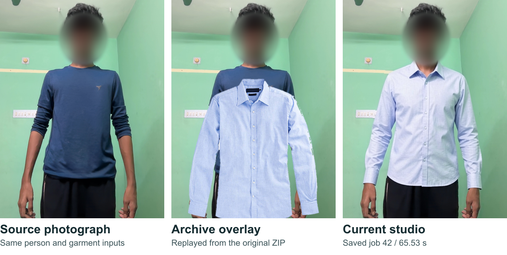
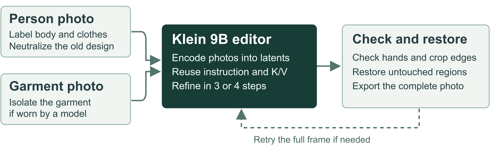

# WeFit

A local virtual try-on renderer for Apple Silicon. Give it a person photo and a garment photo. It locates the clothing, runs a frozen 9B image editor on the relevant part of the picture and returns a complete photograph. The research code here runs on its own. The complete account-based studio is maintained separately.



The original project was supplied by a collaborator. Its default local overlay positioned a product cutout over the body. It also offered hosted and self-hosted AI options. The archive includes no measured AI run identifying the collaborator's engine, hardware and inputs. The centre image is a fresh replay of its default overlay on the same person and blue garment. In that replay the old navy top remains visible above the collar.

**Read the illustrated [engineering report (PDF)](docs/portfolio/WeFit-engineering-report.pdf) or [editable Word version](docs/portfolio/WeFit-engineering-report.docx).** The [interview and demo guide](docs/portfolio/INTERVIEW_AND_DEMO.md) explains each technical term and gives a short presentation script.

## What the project measures

On an M4 MacBook Air with 24 GB, the service rendered the same person and blue shirt six times. The only requested change was the editing region. Each pair used the same model, source bytes, seed 42, neutral clothing conditioning, guidance 1.0 and three steps.

| Region | Pixels rendered | Median service time | Individual times |
|---|---:|---:|---|
| Full photograph | 442,368 | 100.90 s | 67.13, 103.79, 100.90 s |
| Clothing and surrounding context | 331,776 | 83.17 s | 62.05, 88.10, 83.17 s |

The clothing crop reduced median service time by **17.6%**. Each of three pairs finished sooner, with zero crop retries. This experiment covers one person and one garment. The CSV includes timings, queue wait, pixel counts, peak MLX allocation, input hashes and the pinned model revision. [Six recorded requests](docs/portfolio/evidence/region-runs.csv) · [Measurement provenance](docs/portfolio/evidence/measurements.json)


The supplied outputs matched saved app jobs at **65.53 s**, **64.55 s** and **69.40 s**. A separate clean-install studio run displayed 56 s for a blue shirt, 70 s for a polo and 51 s for trousers. A 251.87 s generation belongs to a later full-frame 1024-pixel Klein experiment. The collaborator’s original AI latency remains unverified.

## How it works



- **Prepare the references.** A FASHN human parser locates the source clothes. We fill the old design with grey in a working copy and isolate a target garment when it comes from a shop model.
- **Reuse fixed work.** Two generic instructions are encoded offline with Qwen3. Their verified embeddings replace the text encoder at runtime. The trained reference K/V cache is materialized one layer at a time. Compiled blocks receive the current reference arrays explicitly.
- **Render a clothing region.** The native image transformer and VAE run at a 768-pixel working long side. Standard tops use three steps. Detailed tops and trousers use four. An edge or hand-position failure can trigger one full-frame retry.
- **Return the photograph.** The compositor protects the original head, room and unaffected garments where the masks permit. Unseen skin, tiny lettering and fabric drape remain uncertain. This editor produces still photos. Physical-size accuracy requires wearing trials.

Black Forest Labs trained FLUX.2 Klein. The MFLUX community supplied the Q4 checkpoint. WeFit adds the inference pipeline and evaluation. All transformer blocks are retained. The weights and adapters received no training updates. [Model card](https://huggingface.co/black-forest-labs/FLUX.2-klein-9b-kv) · [Implementation and licensing credits](ATTRIBUTION.md)

## Run a local try-on

Use Python 3.11 on an Apple Silicon Mac with 24 GB of unified memory or more. The tested machine was an M4 Air. Initial setup downloads about 5.3 GB of renderer weights and a 244 MB body parser. The generic instruction cache is already included.

```bash
git clone https://github.com/HXRIkumar/WeFit.git
cd WeFit
python3.11 -m venv .venv
.venv/bin/python -m pip install -r requirements.txt
.venv/bin/python -m tools.download_weights
.venv/bin/python -m uvicorn gpu_service.klein_server:app --host 127.0.0.1 --port 9000
```

In a second terminal in the repository, run the example. The sample uses a face-blurred portrait and a synthetic navy shirt. Personal evaluation inputs stay local. If the full studio already runs on port 9000, its resident Klein service can also serve this request.

```bash
mkdir -p artifacts
curl --fail-with-body http://127.0.0.1:9000/tryon \
  -F 'person=@examples/person.png' -F 'garment=@examples/garment.png' \
  -F 'cloth_type=upper' -F 'garment_photo_type=flat-lay' \
  -o artifacts/try-on.png
```

Open `artifacts/try-on.png` to see the result. Use `garment_photo_type=model` for a reference worn by another person and `cloth_type=lower` for trousers. The API also exposes a local browser form at `http://127.0.0.1:9000/docs`. End the server with Ctrl+C.

## Repeat the experiment

```bash
.venv/bin/python -m pytest -q tests
.venv/bin/python -m tools.compare_regions examples/person.png examples/garment.png \
  --pairs 3 --output artifacts/my-region-runs.csv
python3 -m tools.verify_evidence
```

The included sample is shareable and redacted. Independent runs with it use different input bytes from the private measured pair. To repeat the archive overlay with the original ZIP available locally, see [the evidence notes](docs/portfolio/evidence/README.md). Linux CI runs the CPU contracts and evidence checks. The MLX-specific tests run on Apple Silicon.

## Share or extend the project

Share this repository URL or its PDF with a reviewer. The complete studio, including login, camera timer, saved jobs and the previous Windows FASHN path, is in the owner’s [private application repository](https://github.com/HXRIkumar/wefit-studio), available to invited collaborators. This public renderer targets Apple Silicon. Windows performance and physical fitting accuracy remain unmeasured.
