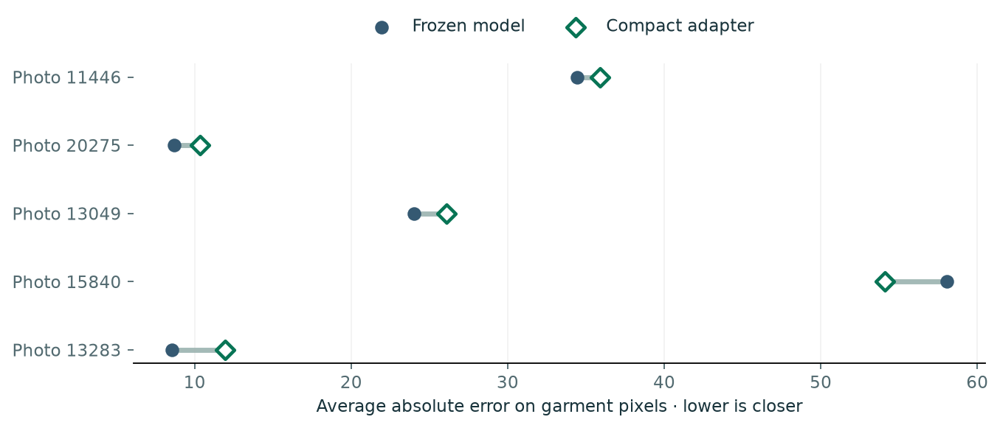
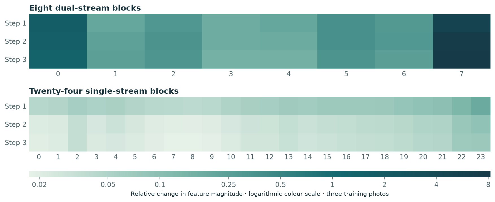
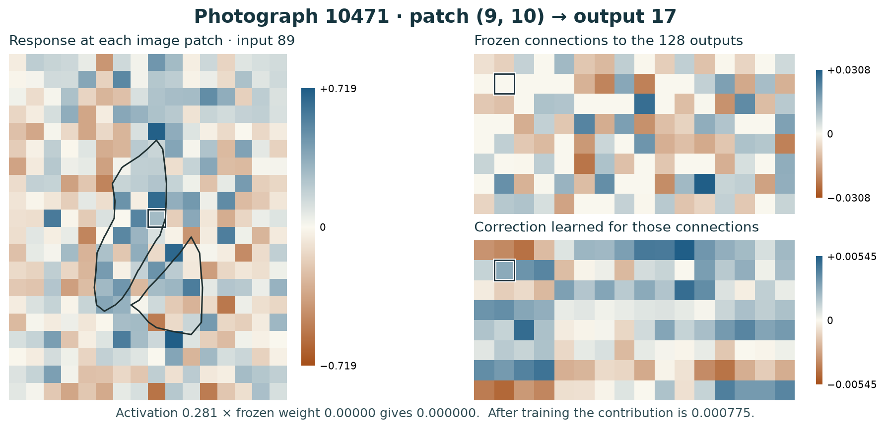
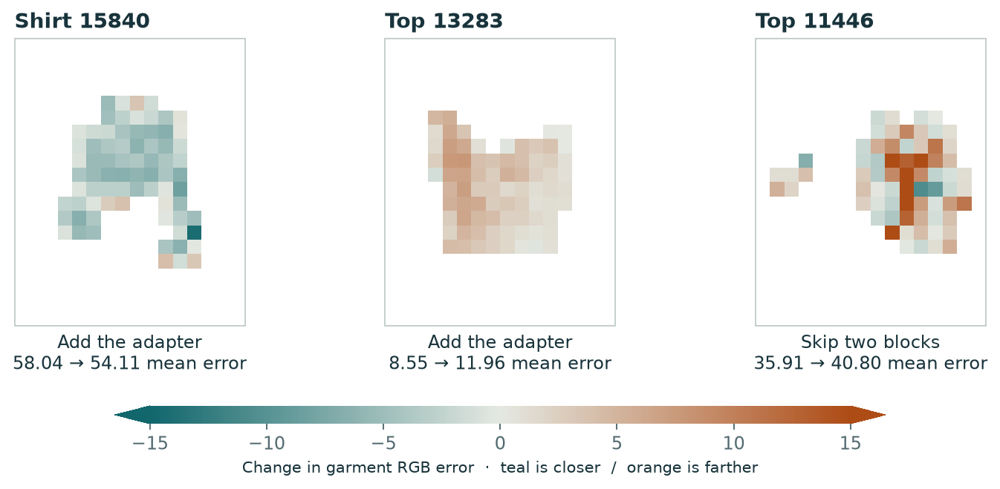
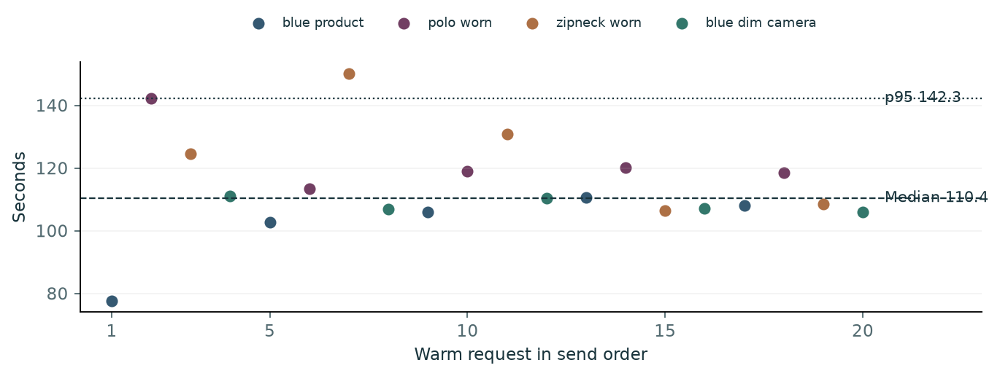
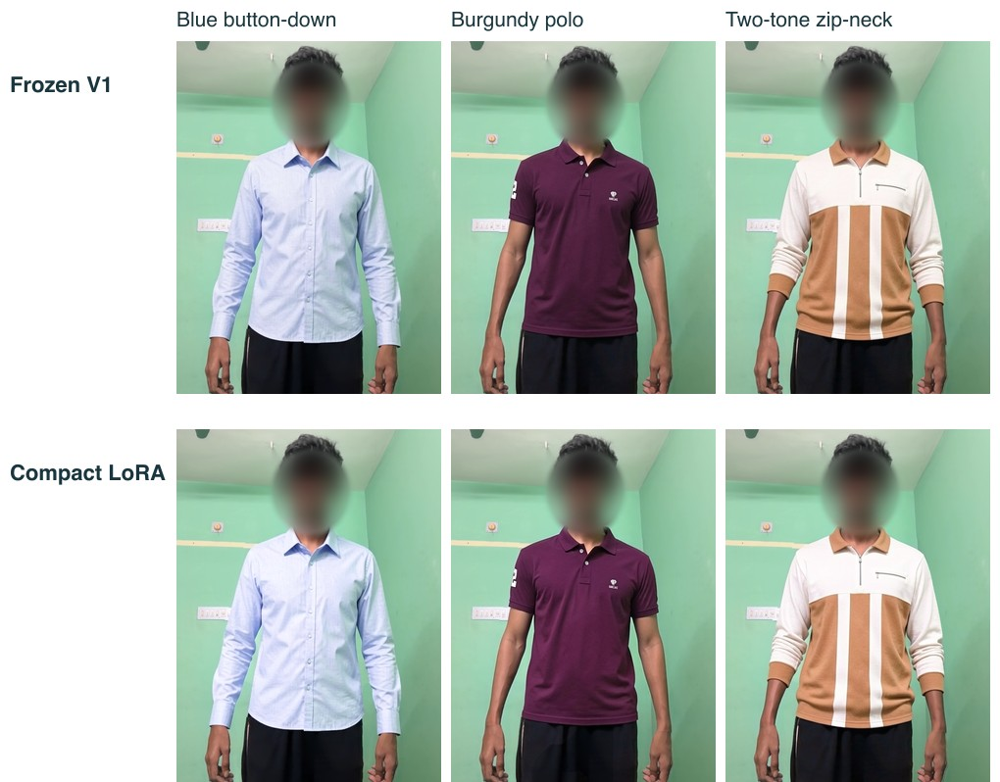

# WeFit V2 research results

**Can a local nine-billion-parameter image editor learn a small garment correction, and which computations can it afford to skip?** We trained an output adapter, inspected all 32 transformer blocks and compared five rendering methods on held-out photographs. The stable V1 remains available at [v1.1.0](https://github.com/HXRIkumar/WeFit/releases/tag/v1.1.0).

[Open the interactive model inspector](inside-klein.html) · [Read the illustrated study](WeFit-V2-study.pdf) · [Reproduce the experiments](REPRODUCE.md) · [Inspect the trained weights](adapters) · [Download the evidence](evidence)

## What we actually fine-tuned

[Follow the training diagram](diagrams/adapter-training.svg) · [Edit the Mermaid source](diagrams/adapter-training.mmd)

Klein produced an image by refining a grid of visual features. The final projection turns **4,096 values for each image patch into 128 output values**. We added two small matrices to that projection on the last of the three rendering steps. A real optimizer updated **16,896 numbers**, 0.000186% of the base transformer’s parameter count. The 9,078,581,248 original transformer parameters stayed frozen. Checksums verified all base transformer and VAE shards before and after the experiment. A zero adapter reproduced a held-out baseline image pixel-for-pixel.

The task was same-garment reconstruction. We greyed out the garment in a labelled real photograph, supplied its cutout as a reference, and trained against the known photograph. Fourteen training images updated the adapter. Five validation images selected epoch **14** of 30. Five more images were held out for evaluation. Each input was 256 × 320 pixels. This small task gives a known target for measuring the edit. Styling a different person in a new garment still needs a human comparison. [Per-image provenance and split](evidence/manifest.json) · [Training history](evidence/training.csv)

For each training photo the adapter predicted a correction from the frozen features. The loss averaged squared error on the garment’s encoded patches and added a quarter-weight penalty for changing surrounding patches. AdamW used a learning rate of 0.001, weight decay of 0.01 and a gradient norm limit of 1. One photo produced one update. [Training implementation](../../tools/adapter_study/fit.py)

The expensive part was producing real features with the frozen 9B editor. The 14 training and five validation photos took **894.20 cumulative seconds** to process. With their features already stored, the 420 optimizer updates and training-loop scoring took **2.95 seconds** on the CPU. The five held-out feature extractions were separate. [Per-photo extraction times](evidence/feature-extraction.csv)

Training garment latent mean squared error went from **0.5956** to **0.5450**. On validation it went from **0.7179** to **0.6893**. The same error fell from 0.6980 to 0.6789 on the unseen photos. This measures disagreement in the model’s compressed image representation. The comparison below measures decoded pixels.

## What changed in the pictures

The five validation images all used Fashionpedia's top/T-shirt/sweatshirt label. The test split contained three such photos and two shirt/blouse photos. Training included one cardigan. These splits supply no held-out jacket or trousers result.

The compact adapter’s mean garment pixel error was 0.939 levels higher than V1 on a 0–255 scale. It improved 1 of five held-out photographs. Frozen 26.749, trained 27.688, compact 27.688. The uncompressed rank-four adapter improved 1 of five. The mean absolute difference outside the garment, relative to the known photograph, was 6.058 with V1 and 6.431 with the compact version. Means give equal weight to each photograph.

The trained file shrank from 68,834 to 35,042 bytes (49.1%). The original 9B checkpoint kept its full size. We first trained rank four with 32-bit values. The compressor tested ranks one through four at 16-bit storage using validation photos. It selected rank **4**. The loader expands the small matrices for the calculation. Halving the adapter’s file precision does not halve the base model’s inference cost. [Compact selection](evidence/compression.json) · [Five held-out results](evidence/held-out.csv)

## What the activation probes saw

Eight transformer blocks handle image and text features separately. Twenty-four blocks process a combined stream. On each of three steps for three training photographs we measured the size of the change from each block’s input to its output. A ratio of 0.25 means the change had one quarter of the incoming feature magnitude. The measured blocks contain 8,724,162,560 logical weights. The ratio describes their collective output.

All 288 observed block visits changed the features (32 blocks × three steps × three training photographs). At the output layer, input 969 ranked lowest and input 479 ranked highest by the training-garment contribution score. A rank is specific to this layer, workload and scoring rule.

In photograph 10471, the highlighted patch produced an activation of about 0.281 for input 89. Its frozen coefficient to output 17 was exactly zero. The learned adapter changes that input’s contribution to about 0.000775. The right-hand colour scales are labelled individually. The inspector lets you repeat this calculation on a different patch or connection.

Among the 4,096 inputs to the final projection, **0 stayed exactly zero** on every observed clothing token in the training set. Of the final layer’s 524,288 dequantized weight entries, 60,855 were exactly zero. We tried leaving those zeros out. Packing the remaining four-bit codes and a bitmap of their positions reconstructed all decoded weights exactly, but the bitmap version took **330,021 bytes** against **294,912 bytes** for the existing dense packing. Tracking the positions cost more than the zeros saved. Lossless DEFLATE compression archived the original packed layer in 241,739 bytes, compared with 246,987 for the bitmap layout. Both decompressed byte-for-byte. These archive sizes apply only to the output layer. [Exact storage experiment](evidence/zero-weights.json)

We ranked input contributions using both observed activation strength and the magnitude of the connected weight column. The inspector shows the spatial responses of five representative channels, their 128 frozen outgoing weights and the learned correction to those weights. It also accepts a trace of a new local shirt. [Raw block measurements](evidence/block-activity.csv) · [Dual stream measurements](evidence/double-block-activity.csv) · [All 4,096 channel scores](evidence/head-channels.csv)

## What happened when work was removed

The lowest measured single-stream residuals were at blocks **8 and 7** (indices start at zero). Each test example ran through every method. We rotated method order and performed one warm-up outside the comparison. The candidate blocks were chosen using training data only. Smaller RGB errors indicate a closer reconstruction.

| Method | Median research render (s) | Garment RGB error | Outside RGB error |
|---|---|---|---|
| Frozen image model | 42.42 | 26.749 | 6.058 |
| Rank-four adapter | 43.50 | 27.688 | 6.430 |
| Adapter, skip one block | 40.74 | 27.823 | 7.839 |
| Adapter, skip two blocks | 39.92 | 30.520 | 9.940 |
| Adapter, mask low quarter of head inputs | 42.09 | 27.547 | 6.453 |

Bypassing both candidates saved 3.57 seconds against the same adapter with every block present. Garment error rose from 27.69 to 30.52 and error outside the garment rose from 6.43 to 9.94. Both blocks remain in the everyday renderer. In the inspector, choose any two methods and a held-out photo to see where the edit improved or damaged the garment. Each coloured square compares the two reconstruction errors on the same annotated pixels. Their weighted sum reproduces the published garment score. [Measured patch totals](evidence/output-maps.json)

One skipped block represents 122,683,904 stored Q4 tensor bytes. These experimental paths bypassed blocks in memory. No base checkpoint bytes were deleted. The quarter-head test set 1,024 low-scoring inputs to zero only on the final step. Its dense matrix multiplication still runs. Each method has five timing samples on a small research canvas. The 20-request timing study below measures ordinary studio-sized work. [All 25 runs](evidence/ablation.csv)

## A physically smaller version of the backbone

We also created a separate working checkpoint. The model keeps every transformer block. Twelve projections inside six blocks with the smallest observed residual change now use three bits per weight. Other tensors retain their original precision. We verified the loaded bit widths, then ran five unseen images on both backbones with the same compact adapter.

The transformer and VAE shards shrank from **5,271,889,295 to 5,108,311,431 bytes**, saving **163.58 MB (3.10%)**. Median research render time was 42.61 s for the Q4 control and 40.90 s for mixed precision. Mean garment RGB error was 27.688 and 28.010, respectively. Each number comes from five held-out images at the research resolution. We kept Q4 as the default because both garment and surrounding-image error rose in this comparison. The smaller checkpoint can be rebuilt locally for further tests. [Checkpoint manifest and checksums](evidence/mixed-checkpoint.json) · [Matched runs](evidence/mixed-runs.csv)

## How small can the original model get with every byte preserved?

We archived every model file in the original Q4 download and compared each restored file with its source. The downloader’s hidden cache contains bookkeeping and is excluded. The 10 files totalled 5.283 GB. A standard ZIP occupied 4.780 GB, saving **503.5 MB (9.5%)**. Every transformer shard, decoder shard, tokenizer and index restored to the same SHA-256 as its original. The stored numbers are identical after extraction. Running the model still requires the extracted files and its usual compute. [File-by-file verification](evidence/archive.json)

## What a user actually waits for

### How quickly can we test a different adapter on the same photo?

The adapter changes only the last projection. Once the backbone has processed a specific person, garment and seed, we can save the numbers just before that projection. Trying another adapter on that **same photo** now requires the last projection update, one sampler step and the image decoder. The decoder-only process loads the VAE without the nine-billion-parameter transformer. Saved state can reconstruct its source and stays local.

Across five matched 256 × 320 test images, the Q4 compact adapter took a median **42.614 s** for a complete render and **0.650 s** for a replay with its state already recorded and decoder resident. **15/15** frozen, trained and compact replay outputs matched their independently generated full images pixel-for-pixel. Reading the state and producing the RGB pixels are included in replay timing. The result applies to repeated last-layer experiments on the same input. A new garment still incurs the full model cost. [Replay rows](evidence/replay-runs.csv) · [Run it locally](REPRODUCE.md)

We also tested adapter strengths 0, 0.25, 0.5, 0.75 and 1 on five validation photos. Their mean **decoded garment error** selected strength **1** (zero uses the frozen output). This setting scored 27.688 on the same five held-out photos used above, against 26.749 for V1. This follow-up uses that existing test split again. An independent test set would be needed to confirm the choice. [Validation choice and controls](evidence/replay.json)

### A fresh studio request

On the **24 GB M4 MacBook Air**, the worker first answered after **6.80 s** and the complete local studio after **7.33 s**. Those numbers measure process startup with local weights present. All 20 warm requests were attempted and 20 succeeded. The median was 110.44 s and p95 was 142.29 s, measured by the client. The first request after launch took 55.37 s separately. Server inference median was 110.38 s and p95 was 142.10 s. Automatic crops required **0 full redraws in 20 observed crop attempts**. With 20 observations, nearest-rank p95 is the 19th sorted time. It describes this run on this laptop. Power and temperature were uncontrolled.

There were four repeating photo/product cases, two source portrait captures of one subject and three garments, with three-step standard tops, seed 42 and automatic region selection. The first three cases use the same bright portrait. A single blue product also appears on the dim-camera capture. The original V1 headline of 56.36 seconds described one blue-shirt request. [Raw timings](evidence/requests.jsonl) · [Computed summary](evidence/summary.json)

## Real studio photos and independent review

Each of four private camera/product cases ran through the complete photo-editing pipeline with the frozen and the compact-adapter configurations. **8/8 finished**. The times below measure the runtime call, including source parsing, render and source preservation. Trials alternated the order. Each case has one time per method.

| User photo and product | Frozen | Compact adapter |
|---|---|---|
| Blue button-down | 102.7 s | 98.9 s |
| Burgundy polo | 109.9 s | 110.0 s |
| Two-tone zip-neck | 103.5 s | 101.5 s |
| Dim-camera blue shirt | 95.9 s | 100.3 s |

These pairs show what a new outfit looks like on the source person. The study has no photograph of that person actually wearing each target product. Mean pixel differences between the two results describe how much changed. They cannot grade the correctness of the fit. There are **0 completed human reviews** at publication. Each reviewer receives their own offline packet with randomized A/B sides and rates collar, shoulders, sleeves, fabric, anatomy and scene. [Native run records](evidence/native-pairs.json) · [Pixel differences](evidence/native-differences.json) · [Blind-review protocol](REPRODUCE.md)

The studio also traces a saved upper-body look directly. After a fresh browser upload and real generation, **Trace this look** reopened the inspector on that person’s measured block responses. The exported numeric trace matched an independently run command-line trace of those same inputs. The public evidence contains the verification result, and the personal trace remains on the local Mac. [End-to-end browser check](evidence/studio-trace-check.json)

## What to say at a project review

“I froze a 9B image editor, trained a rank-four adapter at its output layer, and measured its effects on unseen garment photographs. I recorded changes at all 32 transformer blocks and tested whether low activity predicted safe removal. I also measured tail latency with real studio requests and built an interactive viewer to inspect those results.”

The normal studio keeps the V1 renderer as its default. The compact weights are available for explicit research use on Apple Silicon. The full studio’s separate Windows FASHN path still needs a GPU test on the Windows laptop. All model and adapter use is subject to the upstream non-commercial terms. [Native model card](https://huggingface.co/black-forest-labs/FLUX.2-klein-9b-kv) · [LoRA paper](https://arxiv.org/abs/2106.09685) · [Fashionpedia](https://github.com/cvdfoundation/fashionpedia) · [Adapter license and notice](adapters)
