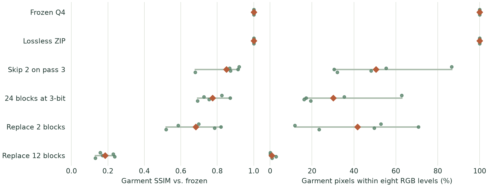
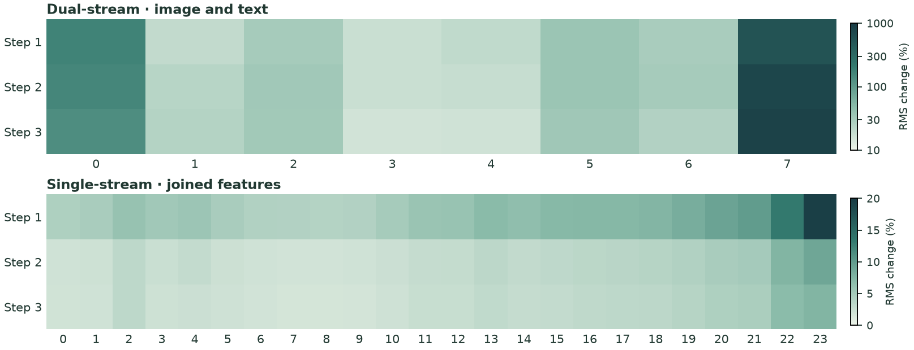
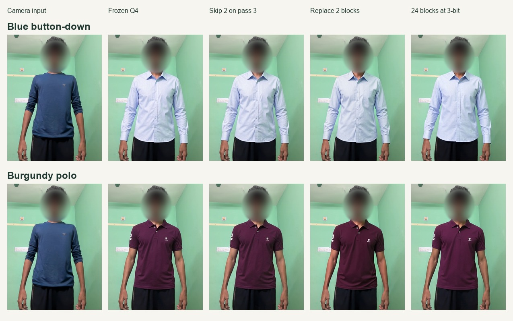
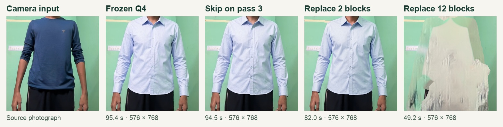

# WeFit V3 · How much of the image editor does a shirt need?

[Explore the offline model lab](depth-lab.html) · [Illustrated PDF](WeFit-V3-depth-study.pdf) · [Editable report](WeFit-V3-depth-study.docx) · [Reproduce the study](REPRODUCE.md) · [Photo-by-photo CSV](evidence/photo-metrics.csv)

We built and loaded a **3,810.3 MB** checkpoint from the **5,271.9 MB** original. Removing 12 dense blocks and fitting small replacements saved **1,461.6 MB**. On five unseen photographs, the garment’s mean structural similarity to the original renderer was **0.185** and **0.8%** of garment pixels stayed within eight RGB levels. This is the measured cost of the most aggressive cut.

For exact output, we also implemented a loader that runs the frozen model directly from its **4,779.9 MB** archive. This saves **503.5 MB** against the same ten unpacked files. Its independently loaded model matched every RGB channel across **6** comparisons, including the blue-shirt camera render. The standard studio keeps the full Q4 editor. V2 remains available at its original release. [Stored model files and hashes](evidence/checkpoints.json) · [Fresh load records](evidence/physical.json) · [Stable V2 release](https://github.com/HXRIkumar/WeFit/releases/tag/v2.0.0)

## Five unseen fashion photographs

| Approach | Stored MB | Median seconds | Garment SSIM | Pixels within 8 | Error to target ↓ |
| --- | ---: | ---: | ---: | ---: | ---: |
| Frozen Q4 | 5,271.9 | 24.19 | 1.000 | 100.0% | 22.09 |
| Q4, direct ZIP | 4,779.9 | 24.20 | 1.000 | 100.0% | 22.09 |
| Skip 7 and 8 on pass 3 | 5,271.9 | 24.55 | 0.850 | 50.5% | 23.63 |
| Two trained replacements | 5,028.3 | 23.87 | 0.682 | 41.7% | 25.12 |
| Twelve trained replacements | 3,810.3 | 16.63 | 0.185 | 0.8% | 66.85 |
| All single-stream projections at Q3 | 4,617.6 | 24.86 | 0.774 | 30.2% | 23.40 |

Each row uses the same five known-target photos at 256 × 320 with seed 42. For each Fashionpedia example, an annotated mask extracts the garment as a product reference and blanks its pixels on the person. The original photograph provides a known target. This tests reconstruction of a garment originally photographed in the same pose. The later camera trials test transfers to a different person or product. The timing column is the median of five fresh renders in a separately initialized process. Q4 storage counts the transformer and VAE safetensors. Student storage also counts the trained replacement weights. ZIP storage counts all ten archived files. The time excludes model loading, the untimed warmup, and PNG writing.

A score of 1 on structural similarity (SSIM) means local pixel patterns match. A score of 0.95 is a similarity index. The “pixels within 8” column directly counts where all three RGB channel values differ by at most eight. Garment error compares against the known photograph, in levels from 0 to 255. A model can differ from the original renderer and still move closer to the photographed shirt. [Paired image metrics](evidence/photo-metrics.csv) · [Wang et al. on structural similarity](https://ece.uwaterloo.ca/~z70wang/research/ssim/)

## What the blocks do

The editor runs eight dual-stream blocks on image and instruction features, then 24 single-stream blocks on the combined sequence. It does this three times. A block's residual is the change it adds to its incoming features. We measured the root mean square of that change divided by the root mean square of its input. For single-stream block 9, that ratio was **4.1%**, **2.0%** and **1.8%** over the three steps. For block 23 it was **19.5%**, **8.9%** and **7.5%**. Large feature values can dominate a root mean square averaged over tokens. The color reports feature movement inside the model. Only an intervention and a decoded photograph reveal how much a collar, sleeve or logo depended on that movement.

## What was trained

Black Forest Labs trained the original FLUX.2 Klein 9B KV. Its 9,078,581,248 transformer parameters and 84,046,115 VAE parameters supplied the frozen teacher. V2 fitted a low-rank LoRA update with 16,896 learned entries at the output layer. V3 trained replacement functions inside the transformer. Their job was to predict the residual that a removed block would have supplied. [Original model](https://huggingface.co/black-forest-labs/FLUX.2-klein-9b-kv) · [V2 adapter study](../study-v2/README.md)

Fourteen training photographs supplied **1,344 block visits** and **896** sampled token vectors per candidate block per step. The recorder sampled garment, other image, instruction and available reference tokens. Some features exceeded float16’s finite range, so it preserved them in float32. Across the 12 selected dense blocks, three step-specific students learned **2,654,208 coefficients**. Recording took **361.1 s** summed over photographs. The numerical fit took **1.78 s** after recording.

For each channel the student learns a scale and offset. It also learns eight shared directions for changes that span multiple channels. We centered and scaled the teacher examples, fitted the diagonal correction, found eight residual directions by eigendecomposition, and fitted a ridge-regularized map into those directions. Averaged equally across 36 block/step pairs, training squared error against the teacher residual fell **37.8%** relative to predicting zero change. Running the fit again on the same saved examples reproduced **all 2,654,208 coefficients** and the entire file checksum. This is supervised low-rank distillation with a closed-form fit. The original 9B weights remain frozen. [Fit code](../../tools/depth_study/train.py) · [Per-block losses](evidence/training.json) · [Repeat fit](evidence/refit.json) · [Learned student coefficients](students)

## Why pale blocks still mattered

Three new validation photos compared **15 methods**. These included skipping one, two, four or twelve blocks on the last pass, larger skips on two passes, reusing a previous residual, removing dense blocks entirely and replacing the same blocks with trained students. Methods were ranked using training data. Selection used the three validation photos. Five previously untouched photographs tested the choices. Two-block identity versus two-block student isolates the contribution of training.

On the test set, two identity bypasses produced garment SSIM **0.682**, against **0.682** for the corresponding trained replacements. Their errors against known garments were **26.61** and **25.12**. Keeping those same blocks on passes one and two and skipping them on pass three yielded **0.850** SSIM. This schedule saves two of 96 dense block visits. It retains every original weight.

The validator selected the last-pass policy under its exploratory quality thresholds. The two-block student had the highest validation SSIM of the three students and missed both quality gates. The 12-block student remained a fixed stress test. In a second experiment we also requantized 48 projections throughout all 24 single-stream blocks from four bits to three, retaining their computations. The secondary rule was recorded after initial validation results and before held-out scoring. [Candidate schedule and gates](evidence/protocol.json) · [Selection](evidence/selection.json) · [Secondary experiment](evidence/quant-protocol.json)

### A part we can prove is unused

The VAE’s final encoder projection emits 64 channels. The pinned inference code splits them in half and uses the first 32 as the mean. The other 32 are discarded, even when their numerical outputs are nonzero. We built and ran the retained 32-row convolution using the original coefficients. This removed **2,080 weights and biases** and saved **4,160 payload bytes** in the layer, about **0.0042 MB**. This cut changes the VAE. The 9B transformer is a separate component. Three actual input images supplied encoder features, and **2 of 2** complete renders using the measured Q3 transformer reproduced its original output exactly. The small physical files in this check contain just the two versions of this projection. The checkpoint sizes in the table describe the independently measured models without this extra cut. [Layer dimensions, saved bytes and image comparisons](evidence/unused-variance.json) · [Runnable probe](../../tools/depth_study/unused_variance.py)

## Full studio on real camera photos

| Camera case | Frozen Q4 | Last-pass skip | Two-block student | 24-block Q3 |
| --- | ---: | ---: | ---: | ---: |
| Blue product shot | 95.4 s | 94.5 s · 0.916 | 82.0 s · 0.739 | 78.2 s · 0.793 |
| Model-worn burgundy polo | 85.6 s | 84.6 s · 0.960 | 81.8 s · 0.755 | 88.6 s · 0.901 |
| Model-worn zip-neck | 82.7 s | 80.4 s · 0.883 | 82.0 s · 0.637 | — |
| Blue shirt in dim light | 75.7 s | 75.0 s · 0.932 | 71.9 s · 0.745 | — |

The native table shows wall seconds for one call per case and setting. Candidate entries also show garment SSIM against the frozen output. All completed images are 576 × 768. The four cases cover one person, two camera captures and three products. Camera inputs undergo parser checks, crop selection, generation and compositing. There is no photograph of the person actually wearing these target products. These comparisons measure output preservation and runtime. The study has zero independent human ratings or physical wearing trials. [Native results and fallbacks](evidence/native.json) · [Q3 camera runs](evidence/quantization.json)

On the real blue shirt, the 12-block student completed in **49.2 s** and passed the studio’s existing crop and anatomy checks. The generated torso visibly loses the shirt. A successful request therefore counts as execution success only. The full checkpoint remains the default.

### Why repeat renders changed at the edges

All five small test images reproduced exactly for each independently loaded checkpoint. On the full-size blue photo, **3** nonbaseline methods initially disagreed with their earlier studio runs on a combined **12,143 RGB channels**. We then held the source, already-generated image and segmentation labels fixed and ran only the final composite. Two successive calls differed on 795 channels. Resetting OpenCV's random seed made them match. The studio now initializes that seed once per complete composite. We reran every affected in-memory intervention and compared it to its separately loaded checkpoint. The repeat records preserve both the original differences and the final comparisons. [Matte isolation experiment](evidence/matte-diagnostic.json) · [Full-size repeats](evidence/native-reload-audit.json) · [OpenCV GrabCut implementation](https://github.com/opencv/opencv/blob/4.x/modules/imgproc/src/grabcut.cpp)

## Startup, memory and warm renders

| Approach | Python model + parser load | Resident MLX after load | Peak MLX in five renders | Five-render median / maximum |
| --- | ---: | ---: | ---: | ---: |
| Frozen Q4 | 2.74 s | 5.32 GB | 6.72 GB | 24.19 / 25.56 s |
| Q4, direct ZIP | 17.10 s | 5.32 GB | 6.72 GB | 24.20 / 25.55 s |
| Skip 7 and 8 on pass 3 | 2.93 s | 5.32 GB | 6.72 GB | 24.55 / 25.54 s |
| Two trained replacements | 3.75 s | 5.08 GB | 6.47 GB | 23.87 / 25.30 s |
| Twelve trained replacements | 3.58 s | 3.86 GB | 5.26 GB | 16.63 / 16.87 s |
| All single-stream projections at Q3 | 3.74 s | 4.67 GB | 6.06 GB | 24.86 / 25.67 s |

Each row starts a new process. Startup measures construction of the renderer and CPU clothing parser with model files already available. One training photo warmed the process before the timed evaluation. Peak MLX bytes cover the Metal runtime’s allocations. Python, the CPU parser and the rest of the operating system consume additional memory. The five-observation nearest-rank p95 equals the maximum here. For ordinary studio latency the V2 release also records 20 warm full requests, with median 110.44 s and p95 142.29 s. Laptop heat, policy order and background activity can affect timings. [Process logs](evidence/physical.json) · [Original 20-request studio study](../study-v2/evidence/requests.jsonl)

## Can the same photo try another garment faster?

This additional experiment keeps all 32 blocks and all three rendering steps. The VAE encoder turns each reference photograph into an array of image features. When the next outfit uses exactly the same prepared person or garment image, a bounded worker-local cache can reuse that reference's features. The denoiser still generates the new outfit in full. We primed the cache on the blue shirt, then alternated the order of enabled and bypassed runs across three changed input pairs.

| New input after priming | Original encoder | Reuse enabled | Cached references | Maximum RGB difference |
| --- | ---: | ---: | ---: | ---: |
| Burgundy polo, same photo | 87.21 s | 86.61 s | 1 | 0 |
| Zip-neck, same photo | 81.60 s | 81.79 s | 1 | 0 |
| Same blue shirt, different camera photo | 76.79 s | 77.02 s | 1 | 0 |

The cache reused **3** references. **3 of 3** complete outputs matched their paired original render pixel for pixel. The median paired difference, measured as original time minus reuse time, was **-0.19 s**. A positive value means reuse finished sooner. Each setting ran once per case. The retained features stay in worker memory, bounded to 8 MiB, and expire after ten minutes of inactivity on the next access. The feature is opt-in. [Paired times and full-output hashes](evidence/reference-reuse.json) · [Reference cache implementation](../../gpu_service/klein_reference.py)

## Mac, phone, web and Windows

The Q4 archive also needs the clothing parser and cached instructions. Together these assets total **5,059.9 MB** before installing runtime libraries or storing any photos. The original full-size blue try-on peaked at **8.37 GB** of MLX allocations. The CPU parser and operating system use additional memory. [Installed model assets](evidence/deployment-files.json) · [Measured full-size memory](evidence/physical.json)

A separate browser test started the complete studio with the ZIP as its only renderer weight path. It registered a temporary user, uploaded the actual blue shirt and camera photo at a 390 × 844 touch viewport, generated the result and downloaded the saved JPEG. Clicking Generate to seeing the result took **78.5 s**. The downloaded file matched an independent JPEG encoding of the frozen reference byte for byte. The browser ran Chromium on the Mac. This tests a phone-sized client layout. [Browser and downloaded-file check](evidence/archive-browser.json)

The Apple Silicon Mac runs inference locally through MFLUX and MLX. The selected dense weights use MLX quantized matrix multiplication. The low-rank residual uses a compiled MLX function, while SciPy fits the students offline. No paid GPU was used. The browser lab is a portable, self-contained file. In the studio a browser uploads the photos to its host, and that host renders the result. The default address uses loopback on the host computer. Another device would need secure access to that host, for example via a trusted HTTPS reverse proxy. [MLX quantized matrix multiplication](https://ml-explore.github.io/mlx/build/html/python/_autosummary/mlx.core.quantized_matmul.html) · [Camera access in browsers](https://developer.mozilla.org/en-US/docs/Web/API/MediaDevices/getUserMedia)

On-device iPhone, Android and WebGPU generation for this checkpoint remains unverified. A port must handle the denoiser, the VAE, the reference cache, the parser and temporary tensors within the target device’s memory and thermal limits. Apple’s Core ML Stable Diffusion work and Qualcomm’s Stable Diffusion v1.5 model illustrate separate mobile pipelines. ONNX Runtime Web documents large-model and WebAssembly limits. The complete studio has a separate Windows FASHN/PyTorch path. The Mac figures above apply to Klein on the tested machine. [Apple Core ML study](https://machinelearning.apple.com/research/stable-diffusion-coreml-apple-silicon) · [Qualcomm model](https://aihub.qualcomm.com/models/stable_diffusion_v1_5) · [ONNX Runtime Web large-model guide](https://onnxruntime.ai/docs/tutorials/web/large-models.html)

## Research context

Intermediate-feature caching and low-rank distillation are existing research directions. We evaluated whether these techniques preserve a particular garment in a three-step, reference-conditioned local editor. The contribution is the matched ablation, the trained residual students, physically runnable checkpoints, directly loadable lossless storage and the public numeric record. The 14/3/5 image split is small. All five held-out annotations belong to the top/T-shirt/sweatshirt category. The camera trials broaden the visible garments to a button-down, a short-sleeved polo and a zip-neck. Jacket and trouser performance was not evaluated in V3. Photo-level separation does not establish person-level separation or garment-size accuracy. [Diffusers caching documentation](https://huggingface.co/docs/diffusers/main/optimization/cache) · [Zavadski et al., Importance-Aware Low-Rank Distillation of Diffusion Transformers](https://arxiv.org/abs/2609.04646) · [Editable architecture source](diagrams/depth-study.mmd)
